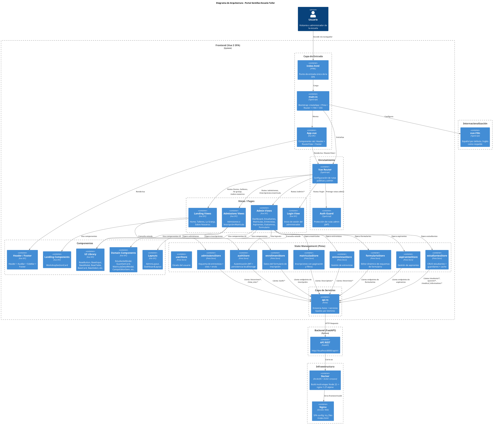

# Arquitectura del Proyecto - Portal Semillas



---

## Descripción de Capas

| Capa | Tecnología | Propósito |
|---|---|---|
| **Entrada** | `index.html` + `main.ts` | Bootstrap de la aplicación: monta Vue, Pinia, Router e i18n |
| **Enrutamiento** | Vue Router 4 | Define rutas públicas (`/home`, `/talleres`, `/admisiones`) y privadas (`/admin/*`) con guardias de autenticación |
| **Vistas** | Vue SFCs | Páginas organizadas por dominio: landing público, formularios de admisión, panel admin |
| **Componentes** | Vue SFCs | Librería UI reutilizable (10 componentes base) + componentes de dominio específicos |
| **Estado** | Pinia 3 | 9 stores que manejan toda la lógica de negocio, llamadas API y persistencia local |
| **Servicios** | Axios | Capa HTTP tipada con instancia centralizada y servicios por recurso |
| **Internacionalización** | vue-i18n | Soporte español/inglés |
| **Infraestructura** | Docker + Nginx | Build multi-etapa y servidor SPA para producción |

## Flujo de Datos

```
Usuario → index.html → main.ts → App.vue → RouterView → Vista
                                                    ↓
                                              Pinia Store
                                                    ↓
                                              api.ts (Axios)
                                                    ↓
                                    Backend FastAPI (localhost:8000/api/v1)
```
